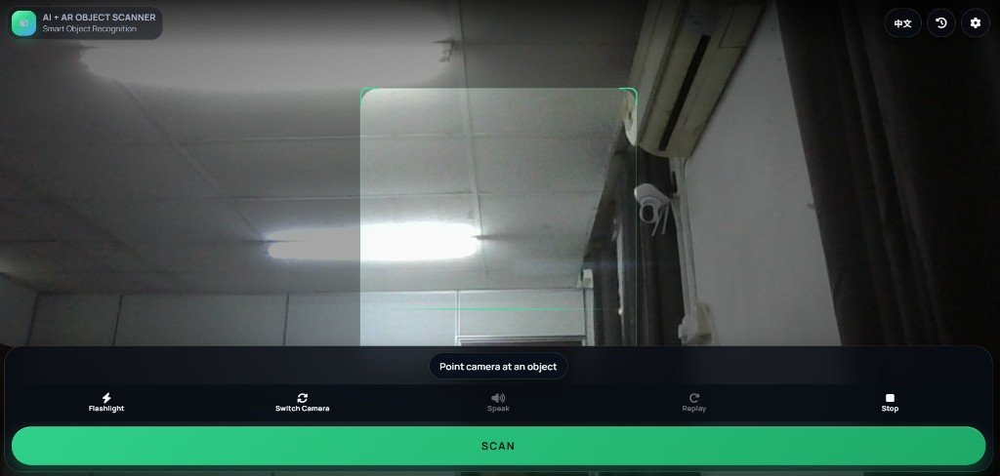
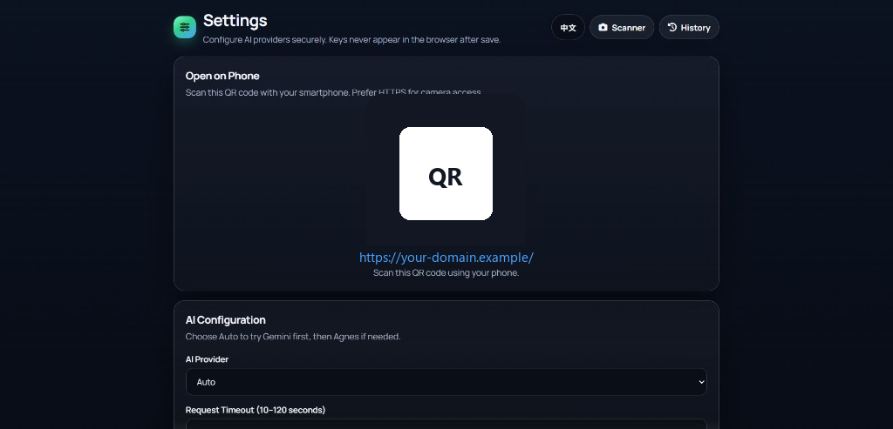

# AI + AR Smart Object Scanner

Phone-first object scanner: live camera, Gemini or Agnes recognition, and an AR product card on the preview.

## Quick start (XAMPP)

1. Place the project in your Apache document root, for example `C:\xampp\htdocs\ai-ar-object-scanner`
2. Copy `config/config.example.php` to `config/config.php`
3. Start **Apache** in XAMPP. Start **MySQL** only if you want scan history
4. Open http://localhost/ai-ar-object-scanner/
5. Open **Settings**, add a Gemini and/or Agnes API key, then click **Test Connection**
6. Return to the scanner, allow the camera, point at an object, and click **Scan**
7. Click **Speak** to hear a short summary. Chinese UI is read in Chinese. English UI is read in English

Optional scan history:

1. Import `database/database.sql` in phpMyAdmin (database name `ai_ar_scanner`)
2. Set the database host, name, user, and password in `config/config.php`. A typical local MySQL account is host `127.0.0.1` and user `root`
3. Turn on **Scan history (MySQL)** in Settings

## Features

- Live rear-camera preview with Scan / Scan Again
- Gemini Vision and Agnes Vision, plus Auto (Gemini first, then Agnes)
- AR detection box and expandable product card
- English / Chinese interface; switching language translates the current result
- Camera resolution (Auto, Standard, 720p, 1080p, High) with automatic fallback
- Camera switch, flashlight, continuous autofocus, and tap-to-focus reticle
- Voice narration, Auto Speak, volume, voice picker, Test Voice, Stop, and Replay
- Each Speak tap reads the result once more; extra taps queue another reading
- Optional haptic feedback on focus, success, and error
- Optional MySQL history (search, details, clear, pagination)
- Optional web product lookup after recognition
- Camera and voice options stay in the browser. API keys stay on the server

## Screenshots

| Scanner | Settings |
|:---:|:---:|
|  |  |

The settings screenshot uses a placeholder address. It does not contain a real site, account, or API key.

## Folder structure

```text
ai-ar-object-scanner/
├── index.php              Live scanner
├── settings.php           AI, camera, and voice settings
├── history.php            Optional scan history
├── api/
│   ├── recognize.php      Image to AI result
│   ├── translate-result.php
│   ├── settings.php
│   └── history.php
├── assets/
│   ├── css/app.css
│   └── js/                camera, voice, haptic, scanner, i18n, settings
├── config/                Example config and local config.php
├── includes/              Gemini, Agnes, recognizer, history
├── database/database.sql
├── docs/screenshots/
└── storage/               Runtime settings and logs
```

## 1. XAMPP setup

1. Copy this folder into the Apache document root
2. Start **Apache** in the XAMPP Control Panel
3. Copy `config/config.example.php` to `config/config.php`
4. Open the scanner URL for that folder
5. On **Settings**, save at least one provider:
   - Gemini model: `gemini-flash-latest`
   - Agnes model: `agnes-3.0-flash`
   - Agnes fallback: `agnes-2.5-flash`
   - Agnes base URL: `https://apihub.agnes-ai.com/v1`
6. Click **Test Connection**, then open the scanner

PHP 8.2 or newer is enough (8.3 preferred). Enable `curl`, `json`, `mbstring`, and `openssl`. Enable `pdo_mysql` only if you use scan history.

Camera access needs a secure page. `http://localhost` works on the same computer. A phone on the same Wi-Fi needs HTTPS, or the site hosted on a real HTTPS domain.

## 2. Scan an object

1. Allow the camera when the browser asks
2. Point at a clear product or object
3. Click **Scan**
4. Wait for capture, AI identification, product lookup, and the result card
5. Click the card to collapse or expand details
6. Click **Speak** to hear a short summary, or **Stop** to silence it
7. Click **Scan Again** to clear the result and scan another object

Controls on the scanner:

- Green **Scan** starts a new capture
- Blue **Scan Again** clears the current result
- The bottom bar holds flashlight, camera switch, speak, replay, and stop
- Flashlight and extra cameras appear only when the phone supports them
- Tap the preview to show the focus reticle when tap-to-focus is on

Camera and voice options are saved in this browser. They are separate from the AI keys saved on the server.

## 3. AI providers

| Setting | Purpose |
| --- | --- |
| `ai_provider` | `auto`, `gemini`, or `agnes` |
| `gemini_api_key` | Google AI Studio key |
| `gemini_model` | Primary Gemini model |
| `agnes_api_key` | Agnes bearer token |
| `agnes_endpoint` | Base URL ending in `/v1` |
| `agnes_model` | Primary Agnes model (`agnes-3.0-flash`) |
| `agnes_fallback_models` | Backup model (`agnes-2.5-flash`) |
| `request_timeout` | 10–120 seconds |

**Auto** tries Gemini first. If that call fails or the result is incomplete, it tries Agnes.

After you save Settings, keys are stored in `storage/settings/runtime.json`. The browser only sees “Key saved” or “Not configured”.

Frames sent to AI are resized to about 1280px and compressed as JPEG, even when the camera preview is higher resolution.

## 4. Voice and language

- **Voice Narration** turns spoken results on or off
- **Auto Speak** reads the result as soon as recognition succeeds
- **Speak** reads the latest result again. Click it again to queue another reading
- **Stop** cancels the current reading and any queued readings
- The voice follows the on-screen language
- Switching language updates the buttons immediately and translates the current card without covering the camera
- **Test Voice** on the Settings page checks volume and the selected voice

Speech uses the browser Web Speech API. No extra voice service is required. Some mobile browsers stay silent until the page has been tapped, and many do not expose a flashlight API.

## 5. Optional MySQL history

History stays off until you turn it on.

1. Import `database/database.sql`
2. Set `db_host`, `db_name`, `db_user`, and `db_pass` in `config/config.php`
3. Enable **Scan history (MySQL)** in Settings
4. Open **History** to search or clear rows

Only text is stored (name, maker, description, confidence, provider). The photo is not saved.

## 6. Phone and HTTPS

1. On Settings, the QR code opens the scanner on a phone
2. Use `https://` on a real domain so the phone can open the camera
3. Allow camera permission for that site
4. If the torch or a second camera is missing, the phone or browser does not expose it. Scanning still works

## 7. Shared hosting

1. Upload the project into a folder under the web root, then extract it
2. Select PHP 8.2 or newer and enable `curl`
3. Make `storage/`, `storage/settings/`, and `storage/logs/` writable
4. Copy `config.example.php` to `config.php` on the server
5. Turn on HTTPS and open the site with `https://`
6. Save API keys in Settings and run **Test Connection**

Do not upload `config/config.php` or `storage/settings/runtime.json` if they contain real keys or passwords. Those files are listed in `.gitignore`.

## System flow

1. The browser opens the camera and applies the saved resolution, focus, and torch when the device allows it
2. Scan captures one frame and compresses it
3. `api/recognize.php` sends the image to Gemini or Agnes
4. The result is checked, optionally refined with a web lookup, and optionally written to MySQL
5. The page draws the AR box and product card
6. If Auto Speak is on, the browser reads a short summary in the current language

## Security notes

- There is no user login. Treat the Settings page as an admin page on a host you control
- API keys stay on the server and are not printed into JavaScript
- `config/`, `includes/`, and `storage/` are blocked by `.htaccess`
- `config/config.php` and `storage/settings/runtime.json` are gitignored
- Uploaded images are checked before they are sent to an AI provider
- Logs in `storage/logs/app.log` strip secret-like values

## Troubleshooting

| What you see | What to check |
| --- | --- |
| Camera never starts | Use HTTPS, or localhost on the same PC |
| Camera permission was denied | Allow camera for this site and reload |
| Only one camera is available | The phone only exposed one camera |
| Flashlight is not supported | Expected on many devices. Scanning still works |
| Voice narration is not supported | The browser has no Web Speech API |
| AI provider is not configured | Save a Gemini or Agnes key in Settings |
| Connection test fails | Check the key, model id, endpoint, and outbound HTTPS |
| History page says history is disabled | Import the SQL file, set `config.php`, then enable history |
| Language switch feels stuck | Refresh once so the latest `assets/js` files load |

## License

This project is licensed under the [MIT License](LICENSE).
